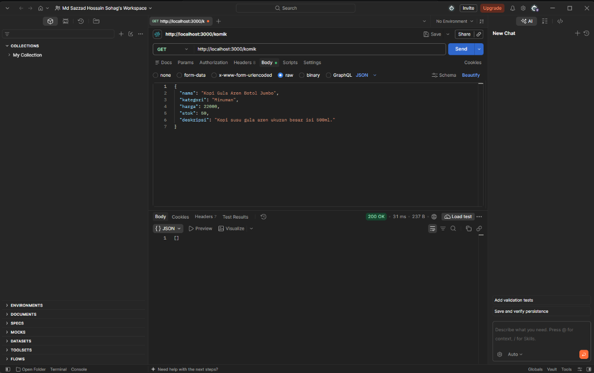
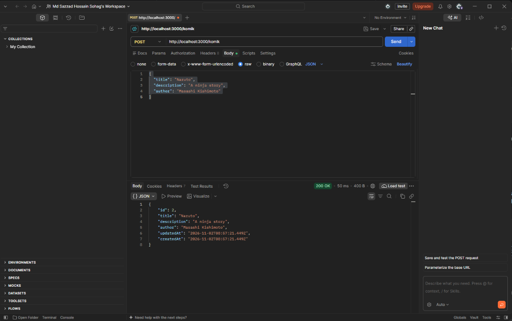
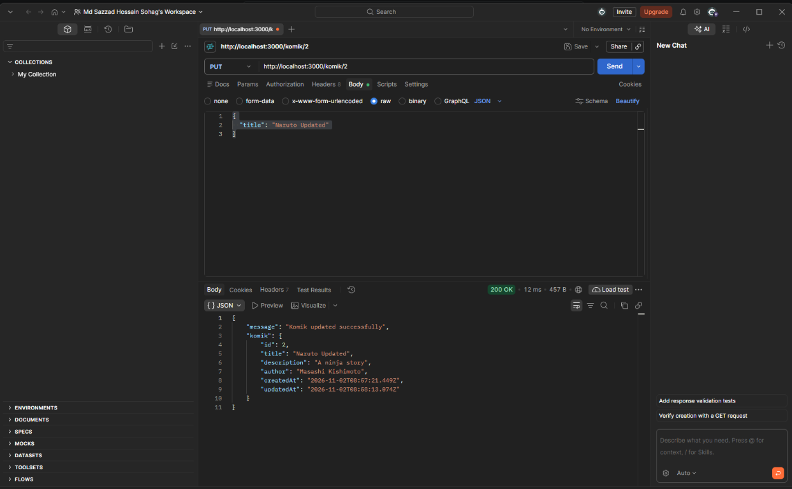
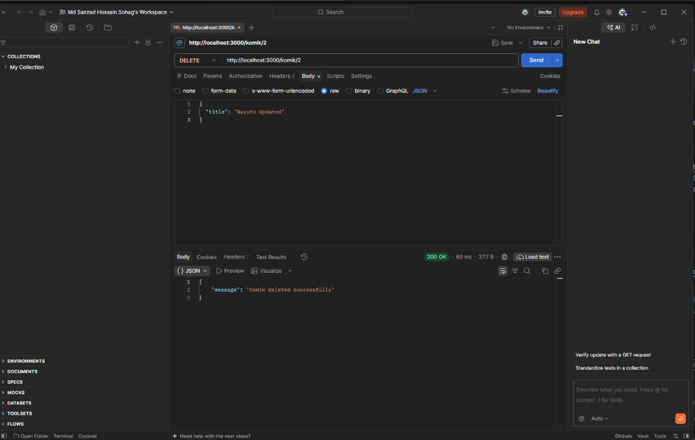

# Komik API

Simple Express and Sequelize API for managing komik records.

## Run locally

```bash
npm install
npm start
```

The API runs at `http://localhost:3000`.

## Endpoints

All request bodies use `application/json`.

### GET `/komik`

Returns all komik records.



### POST `/komik`

Creates a komik record. Send `title`, `description`, and `author` in the
request body.



### PUT `/komik/:id`

Updates the komik identified by `id`. Include the fields to update in the
request body.



### DELETE `/komik/:id`

Deletes the komik identified by `id`.


